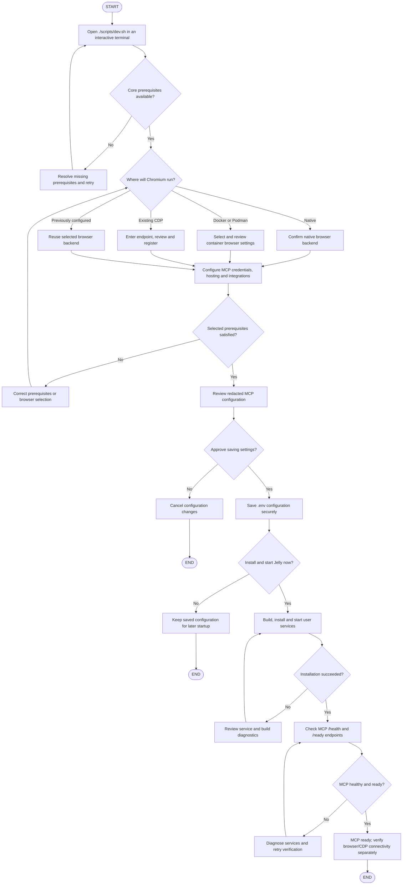
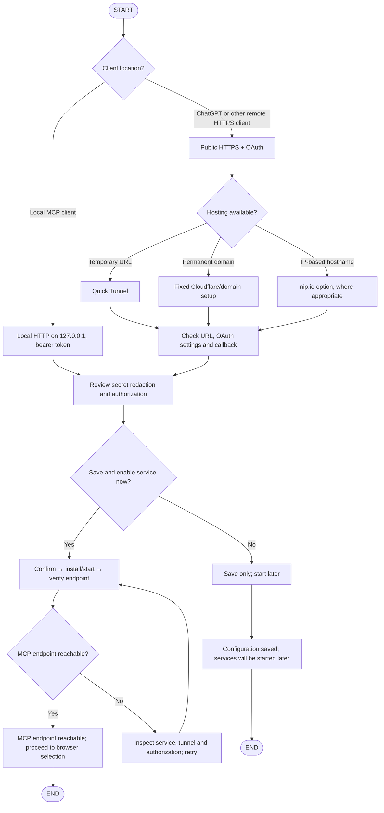
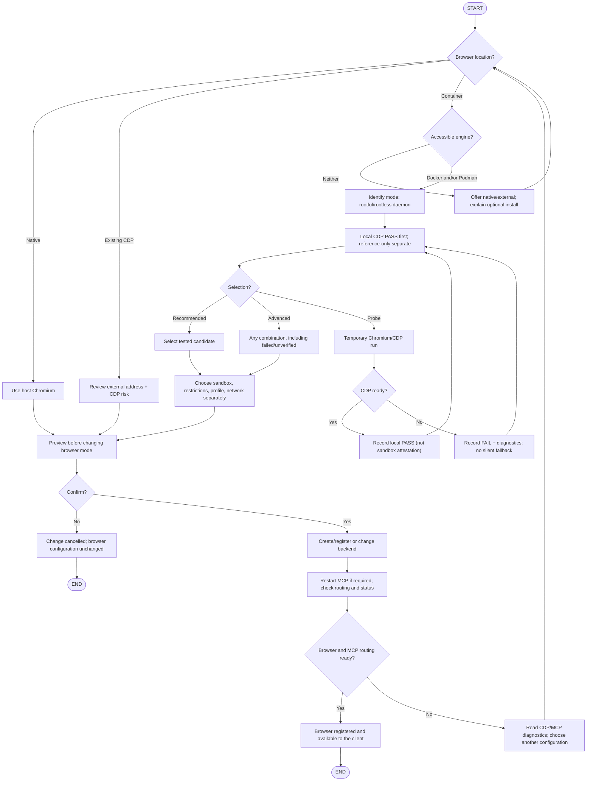
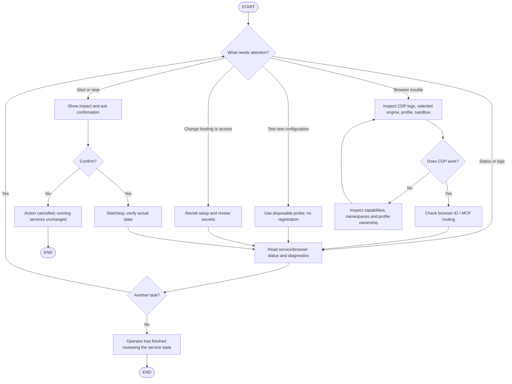
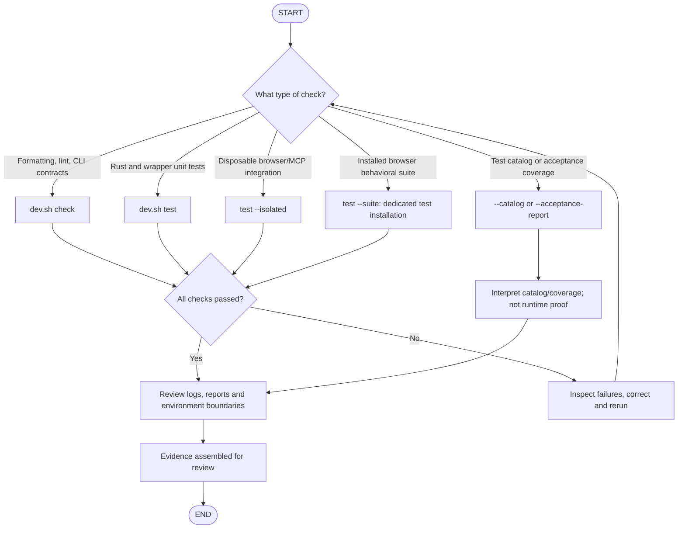

# CLI Processes Diagrams

**Jelly CLI workflows, from first-time setup to browser operation and verification.**

This document defines the main CLI processes for readers who want to understand how Jelly works. Each chapter explains its purpose and shows the decisions, actions, and outcomes in a Mermaid diagram.

**Flowchart conventions:** Pill-shaped **START** and **END** nodes mark process boundaries; rectangles represent actions, diamonds represent decisions, and labeled arrows show the possible paths.

## Table of Contents

- [1. Quickstart: from intention to a working browser](#1-quickstart-from-intention-to-a-working-browser)
- [2. Connection and hosting choices](#2-connection-and-hosting-choices)
- [3. Browser environment and security](#3-browser-environment-and-security)
- [4. Operations and recovery](#4-operations-and-recovery)
- [5. Test and release decisions](#5-test-and-release-decisions)

## 1. Quickstart: from intention to a working browser

This process follows the **real** default `./scripts/dev.sh` command. It checks core prerequisites, asks the user to select or keep a browser backend, runs the MCP identity/hosting wizard, saves settings only after review, and then offers to install and start Jelly. The final verification checks MCP health and readiness; browser/CDP connectivity is a separate operational check.

<a href="#top">&uarr; Back to top</a>

## 2. Connection and hosting choices

This process defines how `scripts/commands/setup.sh` chooses the MCP connection path for a local client or an external HTTPS client. It covers authentication, public reachability, review of the selected settings, and the choice to start services immediately or save configuration for later. The outcome is either a reachable MCP endpoint or a saved configuration awaiting startup.

<a href="#top">&uarr; Back to top</a>

## 3. Browser environment and security

This process defines the choices offered by `scripts/commands/browser-container.sh` when configuring Chromium. The user chooses native Chromium, an existing CDP endpoint, or a Docker/Podman container. For containers, engine availability and local CDP evidence inform recommendations, while sandbox, restrictions, profile, and network remain selectable independently. After reviewing and confirming, the CLI either registers a working browser or leaves the configuration unchanged.

<a href="#top">&uarr; Back to top</a>

## 4. Operations and recovery

This process describes how an operator uses Jelly's status, log, and service-management commands after installation. Depending on the issue, the user can inspect current state, confirm a start/stop operation, probe a browser configuration, or revisit access settings. Each action returns to verification so that the process ends with a reviewed outcome or a deliberate cancellation.

<a href="#top">&uarr; Back to top</a>

## 5. Test and release decisions

This process explains how a maintainer selects the appropriate validation command before accepting a change. Static checks (`./scripts/dev.sh check`), Rust tests (`./scripts/dev.sh test`), browser integration tests, and catalog reviews provide different evidence. Failed executable checks lead back to diagnosis and rerunning the selected test; completed checks lead to a review of results and their scope.

<a href="#top">&uarr; Back to top</a> · <a href="../../INDEX.md">Documentation index</a>

